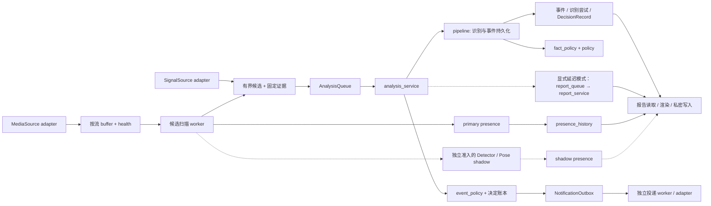

# 技术架构

产品目标、契约与验收门以 [SPEC](../SPEC.md) 为准；业务对象、能力边界和用例见
[业务架构](business-architecture.md)。本文描述代码结构和扩展方式，运行状态以实时检查为准。

## 部署与代码组织

采用**模块化单体 + 有界 worker 进程**：领域规则、用例、适配器和存储在同一个 Python 项目内维护；
需要独立生命周期的采集、候选扫描、顺序分析、通知投递由 systemd user 管理。模块边界不要求网络服务、
额外数据库或消息中间件。核心保持 Python 3.11+ 标准库可运行，模型和媒体工具独立安装与注入。

| 边界 | 负责什么 | 当前实现与扩展位置 |
|---|---|---|
| 领域契约 | 不可变事件、信号、决定、证据与版本校验 | `domain/`；独立协议如 `room_presence`、`identity_protocol` |
| 业务规则 | 什么可成为事实、信号归哪个候选、是否复核/路由 | `fact_policy`、`signal_binding`、`policy`、`event_policy` |
| 应用用例 | 组合规则和 I/O，推动一次任务的生命周期 | `analysis_service`、`pipeline`、`identity_enrollment`、`home_dashboard/application` |
| 输入/输出适配器 | 厂商媒体、模型调用、通知渠道等具体机制 | `adapters/`、`local_runners/`、`notification_transports` |
| 运行与持久化 | 水位、租约、幂等、账本、重试、资源与健康 | `candidate_worker`、`analysis_queue`、`database`、`runtime_trial` 等 |
| 派生展示 | 从已有记录生成日报、时间线、精华与页面 | `reporting`、`reporting_rendering`、`report_queue`、`report_service`、`home_daily_report`、`daily_digest*` |
| 宿主入口 | 参数解析、配置装配、启动/结束进程、格式化 CLI 返回值 | `cli`、`cli_support`、`cli_commands/`、`systemd_deployment` |
| 离线评测 | 对准入证据和明确参考计算质量，不驱动在线执行 | `household_*` 评测契约、`tracker_evaluation/`、`detector_evaluation`、`pose_quality` |

规则模块中的纯计算可以由在线和离线入口复用，不能反向导入模型、队列、数据库或 CLI。
包含配置读取便利方法的契约模块仍应明确该 I/O 边界；静态导入门禁不等于运行时无副作用证明。

## 两条运行主线

连续监督记录和候选事件具有不同采样与统计口径：没有候选事件时 primary presence 仍可继续产生。
shadow 使用独立配置、mode 和低频节拍，不能覆盖主检测或自动晋级。HA 只提供离散 SignalSource，
不承担媒体底座；RTSP 只是 MediaSource 的一种传输方式。

## 事件分析用例与规则

`analysis_service.execute_analysis_run_once` 是一个不依赖 CLI 的应用入口。
`AnalysisDependencies` 由宿主注入主/次/远端适配器工厂、复核策略和 GPU 探测。
它们是延迟回调：GPU 忙或队列空时，不构造模型适配器；成功结果复用本次主适配器实例。
现有 CLI 函数保留兼容签名，只装配依赖并委托服务。

当前业务顺序明确保留：

1. 预检自动本地通知策略及配置 sink 绑定，再初始化既有本地账本、检查 GPU 容量。
2. 从有界队列领取一个带租约的任务；空队列或资源繁忙返回 idle/deferred。
3. 核对本地证据，由 `pipeline.process_prepared_event` 顺序识别、校验、记录尝试并持久化事件。
4. 默认生成所属本地日期的详细日报；显式 `--defer-reports` 时只持久化合并刷新请求。
5. 按 `event_policy` 记录 route/suppress；通过现有门后入本地通知 outbox。
6. 完成任务；失败则按原有次数与退避规则保留证据并重试。

`pipeline` 仍负责识别编排、证据引用绑定、幂等事件复用和本地文件处理。`fact_policy` 独立执行
时序描述、宝宝/成人身份的事实边界；`signal_binding` 按 camera、时刻和事件窗口将每条信号绑定到
一个候选。`policy` 决定识别复核层级，`event_policy` 对已完成事件做家庭路由。
二者不得合并：复核要求、事件严重程度、通知渠道选择和实际投递是不同决定。
事实过滤目前使用固定词表与结构字段，不能证明任意自然语言描述正确。应用通知预检由 CLI 与服务
共用；从其他宿主直接调用服务也会在领取任务前拒绝缺策略或 sink 不匹配，不能依赖 CLI 的隐式保证。

保留 `pipeline.enforce_temporal_fact_boundary`、`enforce_subject_identity_boundary`、
`bind_signals_to_candidates` 的旧导入路径。新增业务规则应直接依赖所属规则模块，
不为复用纯函数而导入整个在线管线。

## 适配器与注入端口

具体模型和第三方实现继续藏在适配器后面，核心只组合已批准的实现：

- `RemoteReviewAudit` 位于 `remote_review_port`；远端 provider 只依赖预算/审计端口，
  SQLite 实现 `RemoteReviewAuditStore` 在宿主装配。预算异常与状态枚举保留旧路径 re-export。
  预留额度、记录完成及失败的顺序保持不变；这个结构调整不启用远端上传。
- 身份适配器消费 `identity_enrollment_contracts` 的图像/已验证 embedding 契约；
  授权、批次验证与存储协调留在 `identity_enrollment`。proof 的唯一类型、请求绑定和重放检查保持，
  适配器不为取得数据类型而依赖入库用例。
- `CameraAdapter` / `CameraSource` 是当前媒体接口的兼容名称；新设计使用 MediaSource 语义，
  不强制用户一次性迁移公开 API。物理设备、逻辑流和房间的映射由 `room_registry` 管理。
- `Detector` 与 `PoseEstimator` 分开；tracker 关联不是身份。模型运行器消费固定请求/结果协议，
  不构造应用数据库或通知 outbox。

## 持久化、失败与运行边界

| 状态所有者 | 所有权与恢复语义 | 不应耦合的结果 |
|---|---|---|
| buffer / candidate state | 每流时间线、水位、有限缓冲、扫描与恢复 | 媒体断流不变成宝宝状态 |
| analysis queue | pending/running/completed/failed、lease、attempt、证据绑定 | deferred 不消耗识别尝试 |
| recognition / event ledger | 主/次/远端尝试审计、各阶段受约束结构化结果、决定 | 报告或通知失败不改写已保存模型事实 |
| event policy ledger | 同 policy + camera 的顺序、冷却、聚合、幂等决定 | 其他 camera 的迟到事件不构成同路乱序 |
| notification / archive queue | 各自容量、租约、投递/复制尝试与回执 | 入队和真实投递成功分开 |
| report refresh queue | 每输出日 requested/claimed/completed 版本、claim token、独立重试 | 事件完成不等于日报完成；运行中新请求不会被旧完成清除 |
| runtime trial ledger | 起始基线、截止窗口、失败增量、primary/shadow 统计 | 历史失败总数不冒充本轮失败 |

同步默认仍保留原有语义；选择延迟模式后，分析用例只负责 durable handoff，渲染失败由独立队列重试，
不再消耗分析尝试。若请求写库本身失败，analysis 仍不能完成；事件与请求并非跨账本原子事务，靠原任务
恢复和请求 ID 幂等衔接。通知 outbox 满仍记录入队失败并完成分析，未借本轮更改投递语义。

本地 SQLite 和活跃 spool 位于 WSL ext4。NAS 为可选异步归档目标，不阻塞本地事实与事件写入。
每路轻量采集/扫描独立，模型在共享资源约束下顺序执行；部署 renderer 生成有界 unit，
启动、开机启用、停止结算是不同操作。当前主路径为原生 WSL + systemd user；
Compose 保留 tools-only，Docker 不作为未来必然迁移目标。

## 报告与页面的读写分工

`reporting.DailyReportGenerator` 保留数据库读取、日期、路径分配与私密原子写入；
`reporting_rendering` 只把传入事件、识别尝试和监督统计渲染为 Markdown/HTML。
`ReportArtifacts` 和 generator 的公开接口不变，重构用新旧 UTF-8 内容逐字节比较验证。
所有详细日报调用新增共享私密 `report_lock`，覆盖读取、渲染、两文件发布；先在锁外渲染再只锁文件替换
会让等待中的旧快照覆盖新结果，因此不采用该顺序。锁等待默认最多 30 秒，锁文件不在释放时删除。

`report_queue` 按规范 root + 本地日期合并，固定 timezone 及 UTC 起止；`report_service` 只读事件和监督
统计生成报告，不加载模型或发通知。请求默认等待 30 秒合并，后续请求不推迟首次就绪；生成期间新增请求
保留下一轮 pending。完成/失败以 token + claimed revision 校验，生成器在锁内读取前与发布前复核 claim。
MD/HTML 仍是分别原子替换，只有两份成功后才记录完成，不宣称双文件事务。

CLI 保留同步默认；部署 profile 的 `deferred_reports=true` 才生成独立无网络、无 GPU 设备的有界 worker，
不安装或启动任何服务。前一日同步 timer 仍保留，以覆盖只有 presence 的日期。
操作与故障恢复见[延迟日报](deferred-reports.md)。

`presence_history` 的日统计从 SQLite cursor 逐行校验，Python 内存只保存每 camera 的计数、首末时间、
最大相邻间隔，包含本地日界空档；primary 与 shadow 独立。性能基准只读取合成数据库。
详细报告的事件列表仍一次读取，不能把监督统计的内存改善声称为整份报告的内存上限。

聚合隐私日报 `home_daily_report` 和详细日报有不同的内容/文件准入约束，保留独立写入策略。
前者不披露 camera/event ID 或媒体路径，后者是含证据链接的私密文件，两者不能简单复用全部渲染内容。

`home_dashboard/` 按 `copy`、`ports`、`errors`、`rendering`、`application`、`server`
拆分。共享异常属于 `errors`；rendering 不反向导入 application/server，旧错误类导出仍兼容。
页面调用具备既有授权门的 application 方法，渲染函数本身不启动 worker。

## 可执行依赖规则

`scripts/check_import_rules.py` 构建实际源文件的静态导入图，CI 与本地测试共用：

| 规则 | 允许 | 拒绝 |
|---|---|---|
| domain | 标准库与 domain 内部 | 其他项目模块 |
| fact_policy / signal_binding / policy / event_policy | domain、上述业务规则模块 | 应用编排、适配器、持久化、CLI |
| adapters / local_runners | 领域与受审协议 | 已登记的数据库、队列、运行/输出基础设施 |
| CLI 入口 | CLI 内部及需要装配的依赖 | 非 CLI 模块反向导入 CLI |
| 离线评测契约 | 受准入数据、领域与可复用算法 | 已登记的应用基础设施和在线运行面 |
| dashboard rendering | 共享文案/协议/错误 | application/server |
| 全部模块 | 无环依赖 | 导入环 |

解析包含普通 `import`、别名、`from . import`、包 `__init__.py` 的相对导入、多层相对导入及无依赖
叶模块；不执行源文件。越过顶层包的相对导入失败关闭。类型注解导入也进入静态图。
该检查不推断动态 import、不扫描第三方依赖，也不是运行时 I/O 或权限的完整证明。

仅保留两个原有已审例外：`__main__ → cli` 和 `adapters.media → storage`（消费注入的存储端口）。
本轮未新增豁免。新增持久化/应用模块须列入基础设施门禁并补负向测试；引入例外必须同步说明理由。

## 扩展与后续拆分次序

- 新摄像头：接 MediaSource/SignalSource 端口和匿名流映射，不修改宝宝规则。
- 新检测器或模型：完成来源准入和同源离线评测，经冻结 shadow 再决定是否改变部署。
- 新业务规则：在规则层消费现有契约，增加独立事实/推测边界测试，用例只负责装配。
- 新产品输出：读取已存事件和监督历史；如果需要额外媒体或外部投递，使用独立用例及现有授权门。

延迟日报的独立去重/重试已落地为可选路径。后续按实际收益将 tracker 的 batch 契约、算法和持久状态
分开；必要时提取详细报告的专用只读模型，并评估报告队列健康与家庭 Dashboard 的统一展示。
这些是明确的后续工作，不以新增空目录、通用事件总线或网络微服务替代现有可运行实现。
