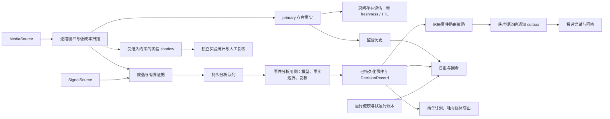

# 业务架构：宝宝监督、事件回看与每日记录

本文说明产品能力由谁负责、事实如何流动，以及新增功能应落在哪个边界。规范性约束以
[SPEC](../SPEC.md) 为准，代码依赖与进程边界见[技术架构](architecture.md)，已完成验证与后续顺序见
[开发计划](../DEVELOPMENT_PLAN.md)。本文描述代码能力，不代表服务此刻运行，也不替代家庭场景验收。

## 产品主线

宝宝监督是首要场景：照护者需要知道系统最近看到了什么、哪些时段没有足够证据、哪些事件值得回看，
并能在一天结束后得到可追溯的记录。系统以两条互补主线实现这一目标：

- **持续监督**：低成本逐路扫描，记录匿名人员存在与覆盖缺口；即使没有形成候选事件，也有监督记录。
- **事件分析**：由检测或离散信号形成有界候选，固定证据，按需解释并决定是否复核，再写入事件账本。

两条主线共享来源标识、时间语义和存储基础设施，但各自保留记录与统计口径。宝宝、老人、宠物等场景
通过配置与经验证的规则扩展同一内核，不复制采集、队列、报告和通知流水线。

图中 outbox 入队仍须满足对应通知配置；route 只是规则选择结果。实验旁路不向 primary、身份、风险或
正式通知写回结论。

## 业务对象与身份

| 对象 | 表达什么 | 代码或契约 | 关系与使用限制 |
|---|---|---|---|
| 物理摄像头 | 一台实际设备 | `PhysicalCameraDefinition`，`room_registry.py` | 一台可有多路逻辑流，设备计数不能按流数累加 |
| 逻辑视频流 | 独立视角与扫描时间线 | `LogicalStreamDefinition`，`RoomRegistry` v2 | 每路独立 health、buffer、scanner；现有契约中的 `camera_id` 通常标识逻辑流 |
| 房间 | 用户配置的空间覆盖对象 | `RoomDefinition`，`room-registry-v2` | 当前每路绑定一个房间，一个房间可由多路覆盖；绑定在流上，不在整台设备上 |
| `MediaSource` | 连续或有界媒体输入 | `adapters/camera.py` 的 `CameraAdapter` / `CameraSource`（现有兼容名称） | 文件、RTSP、桥接都是实现方式；传输协议不承担业务身份 |
| `SignalSource` | 带来源和时刻的离散提示 | `adapters/signal.py`、`SignalEvent` | 摄像头硬件、HA、时序区域等提供候选依据，不自动证明宝宝状态 |
| 匿名轨迹 | 一段有界检测序列中的关联 | `TrackedObjectObservation`、tracker state | 便于时序与区域规则，不是人员档案，也不跨摄像头继承身份 |
| 候选与证据 | 一次可分析的窗口及原始依据 | `CandidateEvent`、`EventMedia` | 固定事件、来源、发生时间与证据引用；重试不得换成别的窗口 |
| 身份推断 | 合格人脸可能匹配已同意录入的档案 | `IdentityAssessment`，`identity_*` | 独立可选能力；匹配仍是 inference，不改写通用 person 事实 |

例如，一台双镜头设备的两个视角分别覆盖两个房间时，产品显示一台设备、两路独立覆盖。多个视角都命中
`person` 时，不据此计算唯一人数或选择宝宝所在房间。真实房间名和设备显示名保存在私有注册表，公开契约
继续使用匿名标识。

## 能力所有权

这里的“所有权”指规则与状态唯一的修改入口，不要求独立服务或单独部署。

| 能力 | 负责的输入与输出 | 主要模块 | 关键边界 |
|---|---|---|---|
| 媒体可用性 | 输入媒体 → 分段、时间线、运行健康 | `adapters/camera.py`、`ring_buffer.py`、`media_health.py` | 断流属于运行问题，不能生成宝宝事件 |
| 候选生产 | 检测/信号 → 合并窗口、证据、持久任务 | `candidate_worker.py`、`pipeline.py`、`signal_binding.py`、`analysis_queue.py` | 扫描水位和队列租约归 worker/queue；信号绑定规则独立于 I/O |
| 监督事实与房间评估 | 逐段 person/clear/gap → 流历史与房间报告 | `candidate_presence.py`、`room_presence.py`、`room_registry.py`、`presence_history.py` | 流事实、房间评估、primary/shadow 各自保留语义与统计 |
| 事件分析 | 固定候选/证据 → 模型尝试、最终事件、复核决定 | `analysis_service.py`、`pipeline.py`、`fact_policy.py`、`policy.py`、`recognition_attempt.py`、`database.py` | service 协调任务及输出，pipeline 编排识别/审计/落库；纯规则不读取媒体或数据库 |
| 事件路由 | 已完成事件 → route/suppress 与原因 | `event_policy.py`、`event_policy_runtime.py` | 纯规则计算与持久决定分开；同策略、同路的时间序与冷却相互绑定 |
| 通知投递 | 已持久化消息 → 尝试、重试、回执 | `notification.py`、`notification_transports.py` | 渠道授权独立于路由决定；file sink 回执不代表手机或邮件已收到 |
| 日报与回看 | 既有事件、监督统计 → 派生展示 | `reporting.py`、`reporting_rendering.py`、`report_queue.py`、`report_service.py`、`home_daily_report.py`、`home_dashboard/` | 展示不生成新事实、启动模型或作风险决定；刷新有独立版本与失败状态 |
| 精华与归档 | 已绑定证据 → 计划、成品、归档记录 | `daily_digest*.py`、`archive*.py`、`storage.py` | 计划不读媒体；导出与归档各有状态，不覆盖原事件 |
| 运行治理 | health、队列、试运行基线 → 可用性与增量结论 | `candidate_health.py`、`runtime_status.py`、`runtime_trial.py`、`systemd_deployment.py` | 运行通过、代码测试通过与模型能力通过是不同验收 |
| 评测与准入 | 固定输入、标签、模型版本 → 诊断与准入证据 | `source_admission.py`、`household_*`、`tracker_evaluation/`、`detector_evaluation.py`、`pose_quality.py` | 离线结果不直接变更生产模型、业务规则或投递权限 |

新增 `fact_policy.py` 承担时序事实与主体身份的纯业务边界，`signal_binding.py` 承担信号和候选的确定性
绑定；二者供在线用例和离线验证复用。`analysis_service.py` 负责队列领取、调用 pipeline、生成或排队日报、
路由/通知入队及任务完成；`pipeline.py` 负责识别编排、证据绑定、尝试审计、事件持久化与文件处理，
并保留旧规则导入入口。业务规则变更应在规则模块完成，CLI 与 worker 负责输入装配、任务调度和用例调用。

## 每一层结论的含义

| 记录或字段 | 可以回答 | 不能据此推出 |
|---|---|---|
| `MediaSourceHealth`、candidate health、`RuntimeStatus` | 连接、扫描、队列是否新鲜可用 | 画面无人、宝宝安全、模型判断正确 |
| `StreamPresenceSample` | 本次成功扫描命中 person、未命中，或存在覆盖缺口 | clear 等于房间无人，或 person 等于宝宝 |
| `RoomPresenceReport` | 根据新鲜样本、确认次数与 TTL 得到的匿名存在状态 | 唯一人数、宝宝位置、跨镜头身份 |
| `VLMEvent.observations` | 有证据支撑的可见或系统检测事实 | 无音频证据的哭声、单帧推定的连续动作 |
| `VLMEvent.inferences`、`IdentityAssessment` | 明确带不确定性的状态或身份解释 | 已确认状态、医学结论、事实真值 |
| `risk_level` | 已记录事件可能的严重程度 | 复核一定完成、通知一定发出、未命中即安全 |
| `DecisionRecord.review_tier` | 为弄清事件需要投入的复核资源 | 事件风险必然上升，或远端上传已经获准 |
| `EventPolicyDecision` | 事件在特定策略下 route/suppress 及原因 | 实际投递权限、投递成功、新的风险判断 |
| `NotificationDeliveryReceipt` | 指定 sink 的一次投递结果 | 其他渠道成功、照护者已经看到或采取行动 |

`clear` 与 `coverage_gap` 必须分别存在：前者有成功扫描，后者没有足够覆盖。房间只有在清空次数门满足、
相关流均新鲜且无缺口时才能暂记 `temporarily_clear`；已有新鲜 person 正证据可以和另一路缺口并存。
主 worker 从实际采样账本产生每片段最多一次 person/clear 确认，使用真实采样时间；账本缺失、
时钟不可靠或首/中/尾覆盖缺口不能成为 clear。早期 person 可与段末 gap 同时保留，后者表示
当前观察不足并打断确认链，不是又一次成功检查。日报事实条数与实际模型调用数分别统计。

事实规则在模型结果持久化前统一执行。没有可信动作或音频事实时，动态描述降为 inference；没有显式主体
证据时，baby/adult 降为 person/unknown。复核频率、证据缺口和模型分歧可以提高复核要求，但不能通过更换
字段名把推测变成事实。
同一过滤也覆盖 `summary_zh`：命中未证实身份/动态描述时，原摘要只在带标记的 inferences
保留一次，展示摘要改为中性提示。免责声明只覆盖自身局部跨度，不为前后子句免责；日报与通知
消费过滤后的持久化结果。此约束适用于新分析阶段，不自动修订旧事件或已发送通知。
当前过滤器使用固定词表与结构字段，不能覆盖任意措辞或证明自然语言正确；真实能力仍需独立真值验收。

## 两条主线的状态与失败归属

持续监督按逻辑流推进 `CandidateScanState`，为有界扫描记录来源指纹和确定性样本 ID。普通 candidate
worker 将 primary 样本幂等写入 SQLite；专用 presence-only/SOAK 只维护有界私密事实文件，不借机产生事件
或打开分析队列。房间评估读取事实并按 freshness/TTL 计算，日报读取历史统计，两者不互相替代。

事件分析依次执行：候选合并与信号绑定、证据固定、持久入队、领取与分析、复核决定和事件落库。
`analysis_service.py` 委托 `pipeline.py` 在模型调用前登记尝试，保存主/次/远端各阶段受约束结果及失败状态；
重用事件 ID 时核对原始绑定，不因重试而重复解释另一份证据。共享分析 worker 顺序消费，摄像头接入数量
不对应常驻 VLM 数量。

事件落库后，路由账本先固定事件与策略指纹的 route/suppress 结果，符合当前渠道约束才进入通知 outbox。
路由重试复用原决定；冷却与聚合按策略和 camera 隔离，防止一条流的迟到事件阻塞另一条流。通知投递失败
留在投递账本，不改写检测、模型结果或事件风险。

延迟日报是显式可选模式：事件分析先将日期刷新请求持久化，再继续路由和完成；“事件完成”与“日报已更新”
必须分开显示。多事件合并到同一输出日，重复交接不重复增长版本。生成过程中到达的新事件保留下一轮刷新，
失败由日报自身重试，不重新识别；达到上限后必须显式重试。仅请求交接失败仍阻止 analysis 完成，不能把
尚未持久化的刷新承诺给用户。前一日 timer 与手动刷新继续覆盖没有事件但存在监督记录的日期。

运行试验使用 `runtime_trial.py` 绑定起始基线，结束时比较本轮扫描、分析、通知与覆盖增量。历史失败保留，
本轮健康不能仅根据全历史失败总数判断。自动停止和结算也是两个结果：结算失败不能阻止已授权的有界运行
停止。8 月验证记录中的 active/disabled 和吞吐计数只描述当时观测，不能作为今日状态。

## 日报、回看与精华

三种输出共用已持久化证据，不承担新的识别职责。

| 输出 | 读者与内容 | 生成路径 | 完成条件 |
|---|---|---|---|
| 私密详细日报 | 照护者查看事件、事实/推测、模型记录、证据链接与监督缺口 | `DailyReportGenerator` 读取数据并私密原子写入；`reporting_rendering` 只渲染 Markdown/HTML | 两种格式采用同一数据来源，输出权限与原子写入通过校验 |
| 聚合隐私日报与状态页 | 快速查看家庭日期、受控计数、最近时间线与覆盖摘要 | `home_event_digest.py`、`home_daily_report.py`、`home_dashboard/` | 不包含详细媒体路径或模型自由文本，读取不启动监督 |
| 本地每日精华 | 按时间和来源去重后的代表片段与入选理由 | `daily_digest_source` 准入 → `daily_digest` 纯规划 → `daily_digest_store` → `daily_digest_export` | receipt 与计划、源证据和成品一致后才可显示可播放完成态 |

primary presence 与 Detector + Pose shadow 分区展示，不能相加后称为监督覆盖或准确率。日报统计包含日界
空档、首末样本及最大间隔；离散命中不能推导连续看护时长、睡眠时长或全天安全。

精华评分回答“为何选中这段既有事件”，不判断家庭关系、温馨程度或安全性。导出失败不影响原事件；无事件、
无精华或没有模型结论时，产品应展示实际覆盖与未知状态。生活回顾默认使用确定性模板，未来可选文本润色也
只能产生独立 narrative，不能回写事实、身份、风险和通知。

## 实验、人工准入与当前能力

评测输入必须固定媒体/来源、模型及配置，报告分开标识模型弱标签、独立人工标签和发布方人工标注。模型
互相同意、JSON 合规或一次零误报只能证明对应测试观察，不能自动成为家庭准确率。

Detector + Pose presence shadow 使用冻结 profile、holdout 与人工盲审的精确绑定，和 primary 独立配置、
独立 mode 持久化；默认 300 秒节拍不改变主扫描频率。实验未到采样时间而跳过不构成 clear 或 coverage gap；
实际实验失败只记录 shadow 缺口。原子视觉谓词、身份匹配及 tracker/detector 评测同样保留各自旁路边界。

| 能力层次 | 仓库已有实现或历史证据 | 尚不能宣称 |
|---|---|---|
| 本地工程闭环 | 文件/实时来源、逐路缓冲、队列、事件持久化、报告、手动有界运行；20BT–BY 留有家庭实跑记录 | 当前正在运行、完整长期稳定性已验收 |
| 匿名监督 | person/clear/gap、房间聚合、primary/shadow 历史与日报分流 | 已认出宝宝，或对夜视、遮挡、婴儿场景达到正式准确率 |
| 事件与复核 | 严格模型契约、中心事实边界、顺序复核、独立审计 | sleeping/crying/possible_risk 枚举存在就等于能力已通过验收 |
| 产品输出 | 本地回看、详细/聚合日报、精华规划导出、路由和可选通知 adapter | 生产外部通知已验收、照护者已实际收到 |
| 高语义扩展 | 身份 sidecar、Pose、原子谓词及家庭诊断工具 | 可靠宝宝身份、生命体征、危险姿势或无人值守看护能力 |

后续推进按“可追溯事实 → 独立真值 → 分条件评测 → 有界 shadow → 明确能力准入”收敛。优先补齐每路均含
有人/无人、进入/离开、远近、夜视与遮挡的独立样本，并分别验收漏检、误报、覆盖和处理延迟；宝宝身份与
高语义状态另设自己的证据和决策门。新 detector 不直接更改宝宝判断，新的报告展示也不隐式扩大业务权限。
