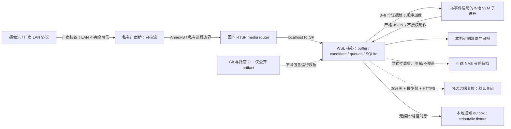

# 家庭宝宝监控系统隐私威胁模型

状态：第一阶段实现基线与可选本地身份增补，2026-08-11

本文件描述当前代码与家庭 WSL 部署的安全边界。它不是安全认证，也不意味着模型、摄像头或家庭环境
“安全”。架构、外部适配器、远端上传、通知目标或删除策略发生变化时，必须更新本文件。

## 1. 保护目标与非目标

优先保护：

1. 家庭视频、截图、音频、日报、事件数据库和生活规律不离开授权边界；
2. 摄像头、厂商账号、NAS、路由器、HA 和远端 provider 凭据不出现在 Git、日志、命令行或数据库；
3. 模型推测不能冒充画面事实，也不能直接触发删除、开门、报警或其他物理动作；
4. 断流、队列积压、磁盘不足和模型不可用必须可见，不得伪装为“宝宝安全”；
5. 开源发行物不包含家庭拓扑、设备标识、私人媒体、模型权重或许可证受限桥接代码。

当前非目标：抵御已取得 Windows 管理员/WSL 用户权限的攻击者、修复摄像头固件或厂商云漏洞、替代
直接照护、提供医疗判断、认证报警或保证事件不漏报。主机被完全攻陷后，本地媒体与凭据应视为已泄露。

## 2. 数据分类

| 等级 | 示例 | 默认处理 |
|---|---|---|
| 高敏感 | 帧、clip、音频、日报、事件 JSON/SQLite、家庭作息、人脸 crop/embedding/模板与身份历史 | 仅本机/NAS；不进 Git/CI/通知正文；远端双开关；身份另需生物特征同意 |
| 机密 | 摄像头/NAS/厂商/HA/provider 凭据、cookie、token、私钥 | 仅私有配置或系统秘密存储；不得记录或回显 |
| 受限元数据 | camera/event/device ID、内部地址、时间线、模型结果、资源状态 | 最小化、匿名 ID、受控日志；公开前审计 |
| 公开 | Apache 自有代码、Schema、合成 fixture、脱敏验证指标 | 可进入仓库，但仍需许可证与发布审计 |

“在家庭 LAN 内”不等于公开，也不等于已经加密或可信。

## 3. 组件与信任边界

边界说明：

- 厂商桥是项目外私有运行树，许可证与凭据都不进入 Apache 核心；当前仅把媒体送入 localhost。
- WSL 核心信任本机用户，但不信任媒体内容、模型输出、provider 响应、NAS 可用性或外部贡献。
- FFmpeg/ffprobe、MediaMTX、模型运行时、随模型加载的 remote code 和 GPU 驱动是第三方执行边界，
  不因核心采用 Apache-2.0、模型文件位于本机或模型仓库声明 Apache-2.0 而可信。
- NAS 尚未配置时使用本地目录；远端 provider、HTTP webhook 和手机推送都不是默认依赖。
- HA 离线适配器只规范化已捕获的 server-to-client event envelope；不连接 HA、不处理认证消息，
  原始 entity/state/context/attributes 不跨入核心 `SignalEvent`。
- Git/CI 是公开边界，只允许生成 fixture、源代码、Schema 和脱敏指标。
- 身份是独立、默认关闭的本地 sidecar，不是 `MediaSource`、tracker、VLM 或通知的隐式能力。当前产品
  只执行同意/删除 preflight，不读取家庭媒体或写模板；内部 matcher、YuNet/SFace runner 与加密模板库
  原语不代表实际 enrollment 已上线。身份 assessment 与 `RecognitionAttempt` / VLM provenance 分开，
  不得互相伪装来源或合并 shadow 结果。

## 4. 主要威胁与当前控制

| ID | 威胁 / 入口 | 当前控制 | 剩余风险与后续要求 |
|---|---|---|---|
| TM-01 | 凭据进入参数、进程列表、日志、SQLite 或 Git | URI 脱敏；子进程环境白名单；`.env`/私有配置忽略；release-audit 不回显匹配值 | 已泄露凭据必须轮换；公开 host 仍需 secret scanning 与私密报告通道 |
| TM-02 | LAN 中伪造、窃听或重放摄像头上游数据 | 厂商桥隔离；核心只消费 localhost RTSP；不开放公网 | 摄像头到桥的厂商协议不由核心保证；应隔离 IoT LAN，不能把视频当作认证事实 |
| TM-03 | 恶意/损坏媒体触发 FFmpeg、解码器或 parser 漏洞 | 有界时长/大小/超时；失败码脱敏；不执行媒体元数据命令 | 当前没有 OS sandbox；公开部署前应固定更新版本、最小权限并评估独立服务账户/容器 |
| TM-04 | 画面、字幕或物体诱导 VLM 产生 prompt injection/幻觉 | 固定问题；严格 Schema；facts/inferences 分离；未知默认 unknown；模型无工具/删除权限 | 结构合规不等于语义正确；必须用人工标签测 hallucination 和 observation precision |
| TM-05 | 本地模型 remote code、动态模块缓存或权重供应链被篡改 | 单模型单独批准；固定 revision；隔离 venv；权重不入发行物；顺序加载。Mage 还要求 materialized 非 symlink control files、官方 AutoClass/processor 形状、全部 root control files 的私有 SHA-256 manifest、人工审查、逐进程确认、offline 模式和每进程临时 `HF_MODULES_CACHE` | manifest 只证明审查后文件未变，不证明代码安全，也未覆盖依赖/驱动漏洞和未实测 Mage 权重；下载后仍需核对权重、依赖锁、实际网络行为与资源峰值，任何 revision 升级都要重审 |
| TM-06 | 远端复核意外上传过多家庭数据 | enable + upload-consent 双开关；默认 false；最多 3 帧；匿名引用；上传/响应/次数/速率预算；HTTPS 外部、HTTP 仅字面回环；禁 redirect/继承代理 | 一旦显式开启，provider 仍能看到所选帧；需要单独隐私条款、费用和删除政策确认 |
| TM-07 | 恶意或异常 provider 响应覆盖本地事实 | 严格 JSON；响应大小/超时；失败保留本地 pending review；无原始响应审计 | 合法 JSON 仍可能错误；高风险结论必须保留来源与人工复核路径 |
| TM-08 | 高频事件、恶意流或游戏占 GPU 导致资源耗尽 | 事件触发、低采样；有界 queues/lease/retry；GPU guard；单 VLM；RuntimeStatus 容量/年龄/磁盘告警 | 16/32GB 主机与 12GB VRAM 仍可能延迟；不得丢证据后伪报 operational |
| TM-09 | 路径遍历、symlink、归档覆盖或 NAS 离线损坏证据 | 安全相对路径；source-root 边界；SHA-256；atomic no-replace；离线 pending/幂等恢复 | NAS 凭据、传输加密、快照/备份和勒索防护需在真实 NAS 接入时单独设计 |
| TM-10 | 自动保留策略误删既有家庭文件 | 扫描/删除默认 false；持久 opt-in + 一次性确认；仅删除项目拥有的明确目标 | 当前未授权真实删除；任何实现都需 dry-run、根路径验证和可恢复性说明 |
| TM-11 | 日报中的模型文字或路径造成 HTML 注入/越界引用 | HTML escape；证据只通过事件白名单解析；报告路径由 StorageResolver 管理 | 浏览器仍会加载本地引用；未来 Web UI 必须加 CSP、认证和独立输出编码审查 |
| TM-12 | 通知泄露媒体/路径、重复投递或静默失败 | 严格无媒体消息；稳定 ID；SQLite outbox；at-least-once；本地 stdout/file；默认关闭；queue health | 正式微信/飞书/webhook 尚未实现；新增 adapter 必须独立授权、目标预览和最小字段审查 |
| TM-13 | SQLite 被并发破坏或本地用户篡改事件/审计 | 严格反序列化；事务/唯一键；状态读取 read-only/query-only；无效 schema 失败关闭 | SQLite 没有内容签名；取得本机用户权限者可篡改，NAS/备份完整性后续设计 |
| TM-14 | 恶意贡献、依赖或 CI action 窃取 token/引入私有 artifact | Git-index release audit；Issue/PR 隐私模板；action 完整 SHA；`contents: read`；checkout 不持久凭据 | Hosted CI 尚未实际运行；依赖锁定、SBOM、DCO 自动检查和持续 secret scan 仍是发布门槛 |
| TM-15 | Windows/WSL 启动项、服务或配置权限扩大 | 当前不安装自动 supervisor；runtime-status 只读；服务不自动修复/上传/删除 | 正式 24/7 supervisor 需重启预算、冷却、账户边界和 Windows/WSL ownership 设计 |
| TM-16 | 使用者把“无告警”理解为“宝宝安全” | 日报/状态明确覆盖缺口与不确定性；GPU defer 不伪装 ready；非医疗/非认证报警声明 | 这是无法完全消除的人因风险；界面、通知和 README 必须持续重复该边界 |
| TM-17 | HA capture 携带认证帧、私有 entity/attributes、畸形消息或事件洪水 | 核心无网络/token 代码；只接受显式映射的 `state_changed`；有界文件/数量/字段；静态白名单输出；哈希 ID；错误不回显输入值 | 真实 listener、认证/TLS、断线重连和 HA 端权限尚未实现；部署时必须只采集 server-to-client 事件并把映射留在 Git 外 |
| TM-18 | 未受信任或被替换的 YOLO `.pt` 权重通过 Python/PyTorch 反序列化执行代码，或类别/坐标契约被悄悄替换 | 仅普通本地文件；严格 manifest 固定文件名、大小、SHA-256、revision、来源、许可证和完整类别顺序；加载后复核 class map；只消费归一化 `xyxyn`；无 manifest/不匹配均失败关闭且不自动下载 | 哈希只证明“与复核对象相同”，不证明上游安全；具体权重仍需用户单独批准、可信来源审查、隔离环境和授权视频实测，运行依赖仍是第三方执行边界 |
| TM-19 | 短期 tracker 把交叉/遮挡目标误关联，或被误当作宝宝身份与确定动作；两份状态写入中断导致观测丢失 | track ID 明确为匿名几何关联；同类别 IoU + age/容量边界；标签/框原样事实；tracker observation 持久 outbox；zone state 先写再 ACK，冲突/重放幂等 | 简单 IoU 仍会 ID switch，不能做 ReID、跨摄像头身份或抱起/离床等高语义结论；真实遮挡/交叉误关联率和长期压力需授权视频验证 |
| TM-20 | 未授权录入、模板窃取/反演或主体与错误 face box 绑定 | 默认关闭；持久生物特征同意 + 一次确认；未授权时在所有媒体/模型/store I/O 前失败；每张录入图必须恰好一张检测脸且通过质量门；AES-256-GCM、0700/0600、拒绝 symlink/hardlink/非 WSL 私有根且不保存原图 | cohort 余弦门只排除明显离群，不能证明 3～12 张图片确属同一主体；仍需人工同主体/遮挡复核；索引元数据不加密，主机攻陷、密钥备份/轮换/恢复仍是剩余风险 |
| TM-21 | 相似脸、低质量、多人、照片重放或 tracker/cross-camera 传播导致错误身份 | matched/unknown/ambiguous/quality_rejected open-set 语义；单 profile 固定 unknown；多人逐 face 独立；不沿 tracker/摄像头传播；身份不改变风险/通知。blur/exposure/roll/yaw/最小脸/眼距/五点几何已固定；公开成人 smoke 为 3 cases/8 faces/4 accepted | 尚无 liveness、自动遮挡检测或 anti-spoofing；家庭独立 holdout 与至少一周 identity shadow 未完成；不能称已识别宝宝，也不能把 unknown 当陌生人 |
| TM-22 | 删除只清在线索引、审计/备份残留或 UI 误报已删除 | 产品支持精确 profile 删除；SQLite 外键、secure_delete 和事务；删除使既有模板快照失效，并分别报告事务已提交、checkpoint 完成或清理待重试 | 在线删除仍不代表 WSL VHD、NAS/主机快照物理擦除；清理重试尚无独立 CLI，备份引用计数、恢复与销毁 gate 仍待 |

## 5. 数据最小化与生命周期

1. 媒体先进入有界循环缓冲；仅候选事件固化前后片段和关键帧。
2. 本地 VLM 不逐帧常驻，只处理事件证据；两个 VLM 不同时驻留。
3. SQLite 保存结构化结果、受控事实和必要相对/本地引用，不保存凭据或模型原始 stderr。
4. NAS 只在显式挂载与配置后接收事件 artifact；离线不阻断本机入库。
5. 远端只在双开关后选择最多 3 帧；不上传 clip、音频、本机路径、camera/event ID。
6. 通知不包含帧、clip、source URI、路径或原始模型响应。
7. 自动删除保持关闭；公开发行物只扫描 Git index，不读取未跟踪家庭数据。
8. 身份默认关闭；preflight 不读媒体或模板。未来录入只短暂处理用户选定的 face box，默认不保留原图/
   crop；embedding 在独立加密模板库，显示别名只作本地元数据，不进入媒体名、事件 ID、通知或日志。
   NASA 成人素材及派生结果只留 Git 外 Tier B 本地 smoke；不进入训练/CI/再分发，儿童公开图片不自动下载。

## 6. 安全失败语义

- 证据不足：`event_type=unknown`，降低置信度，必要时进入本地/人工复核。
- 媒体断流：记录系统健康事实和覆盖缺口，不生成宝宝风险事实。
- GPU 忙/显存不足：保留持久任务并标记 `analysis_deferred`，不停止采集。
- NAS 离线：归档任务保持 pending，不覆盖或删除源文件。
- provider/预算/审计失败：保留本地结果与 pending review，不越权重试上传。
- 通知失败：有界重试后 failed，必须显式 retry，并由 RuntimeStatus 报 attention。
- 输入、数据库或状态契约损坏：错误信息脱敏后失败关闭，不自动迁移或修复。
- 身份同意、模型 hash、质量、模板 provenance、维度、单 profile 或候选 margin 任一不足：返回 unknown/
  ambiguous/quality_rejected，不输出名字、不沿 tracker 续接，也不提高/降低风险或触发通知。

## 7. 部署前检查清单

- [ ] 所有监听地址符合 localhost/LAN 设计，没有 UPnP、隧道或公网端口。
- [ ] 厂商桥、VLM、NAS、HA/provider 凭据只在私有配置，文件权限已核查。
- [ ] 摄像头到桥的 IoT 网络隔离、访客访问和无线安全已由家庭管理员确认。
- [ ] FFmpeg、MediaMTX、模型与 action 使用已审查的固定版本/revision。
- [ ] 任何需要 remote code 的模型都使用 materialized 普通文件、私有 manifest、人工源代码审查、
      隔离动态模块缓存和离线实测；manifest 与权重不进入 Git。
- [ ] 远端、通知和 retention 开关均保持预期默认；远端开关有明确家庭同意。
- [ ] RuntimeStatus 显示媒体、分析/归档/通知队列和磁盘状态；没有把 GPU defer 当故障恢复授权。
- [ ] NAS 目标、容量、权限、不覆盖行为、离线恢复与备份策略用合成 artifact 验证。
- [ ] `release-audit`、全量测试、Ruff、Schema/fixture 验证全部通过。
- [ ] 托管仓库已配置私密安全联系渠道；公开演示只含合成/授权媒体。
- [ ] 使用者明确知道系统不是医疗设备、认证报警或直接照护替代品。
- [ ] 身份保持默认关闭；若启用，持久同意与本次确认可独立核验，明确 subject 与 face box，模板库权限/
      owner/加密状态通过检查，且产品已实现真实原子 list/delete 而非只通过 preflight。
- [ ] 身份 blur/exposure/pose/occlusion 质量门、家庭独立 holdout 和至少一周 identity-only shadow 已通过；
      单 profile、多人、遮挡、夜视、照片重放和跨摄像头均保持保守失败，不与既有 24 小时 shadow 混算。

## 8. 变更触发条件

以下任一变化必须重新审查本模型：新增摄像头/桥接项目、LAN 监听、Web UI、用户认证、正式通知 provider、
远端上传、音频分析、自动控制、保留删除、NAS 协议、容器/root 权限、模型 remote code、CI 权限、公开
demo 媒体、第三方依赖、生物特征同意、身份模板格式/加密/备份、face detector/embedder/阈值、身份进入
UI/通知或任何 tracker/cross-camera 传播。审查结果应记录在 `docs/verification/`，不能只修改风险表而不验证控制。
